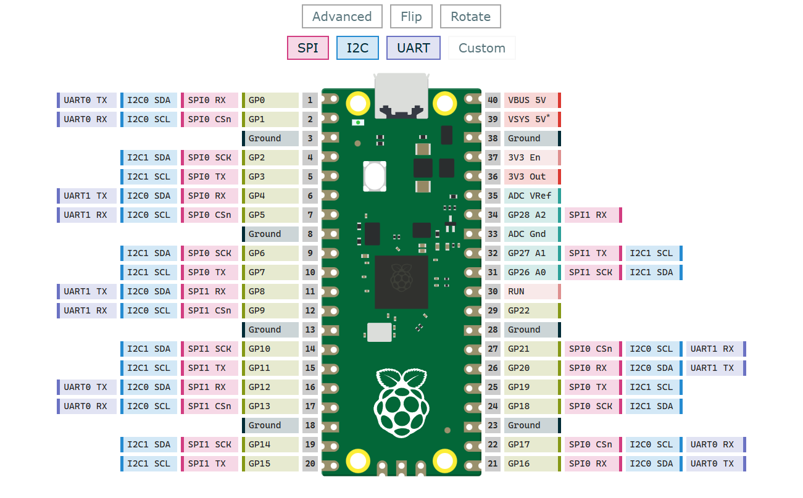

# Embedded Systems I - Portfolio

We use this site to document our lab work with C and the Raspberry Pi Pico 2 (RP2350). It includes 17 practices from the first and second terms, with code and available evidence.

## Team

Becerril Villamil Gustavo, Bermudez Ruiz Uriel Onairam, and Rios Garcia Cristian Ulises.

## First term

| Practice | What it shows |
|---|---|
| [Binary Counter](parcial1/binary_counter.md) | Four LEDs count from 0 to 15 in binary. |
| [Bouncing Light](parcial1/bouncing_light.md) | One LED moves left and right. |
| [Fill and Empty Animation](parcial1/fill_and_empty.md) | Four LEDs show fill and empty patterns. |
| [Fill From the Outside Inward](parcial1/fill_outside_inward.md) | Four LEDs show patterns from fixed values. |
| [AND Gate](parcial1/and_gate.md) | The LED turns on when both buttons are pressed. |
| [OR Gate](parcial1/or_gate.md) | The LED turns on when either button is pressed. |
| [XOR Gate](parcial1/xor_gate.md) | The LED turns on when one button is pressed. |
| [Exam 1 - Stacker Game](parcial1/exam1.md) | A 4-by-5 LED game uses buttons and interrupts. |

## Second term

| Practice | What it shows |
|---|---|
| [ADC Basic](parcial2/adc_basic.md) | Reads an analog voltage on ADC0. |
| [ADC Filtering Level](parcial2/adc_filtering_level.md) | Averages ADC readings and reports a level. |
| [ADC Potentiometer](parcial2/adc_potentiometer.md) | Reads a potentiometer and maps it to an angle. |
| [ADC Temperature](parcial2/adc_temperature.md) | Converts an ADC reading to temperature. |
| [I2C RTC and MPU6050](parcial2/i2c_rtc_mpu6050.md) | Reads clock and motion sensor data over I2C. |
| [PWM Oscilloscope Sweep](parcial2/pwm_oscilloscope_sweep.md) | Changes a PWM duty level for oscilloscope viewing. |
| [PWM Piano](parcial2/pwm_piano.md) | Plays notes with buttons and a buzzer. |
| [Timer Workload](parcial2/timer_workload.md) | Shows timer callback activity on GPIO pins. |
| [UART Bidirectional](parcial2/uart_bidirectional.md) | Exchanges characters over UART and controls LEDs. |

## Run the site locally

Install the dependencies and start the local server:

```bash
python -m pip install -r requirements.txt
mkdocs serve
```

Then open http://127.0.0.1:8000/.

## Board reference



See the [Pico 2 pinout](https://pico2.pinout.xyz/) and the [course site](https://gulden8ag.github.io/embedded1/).
