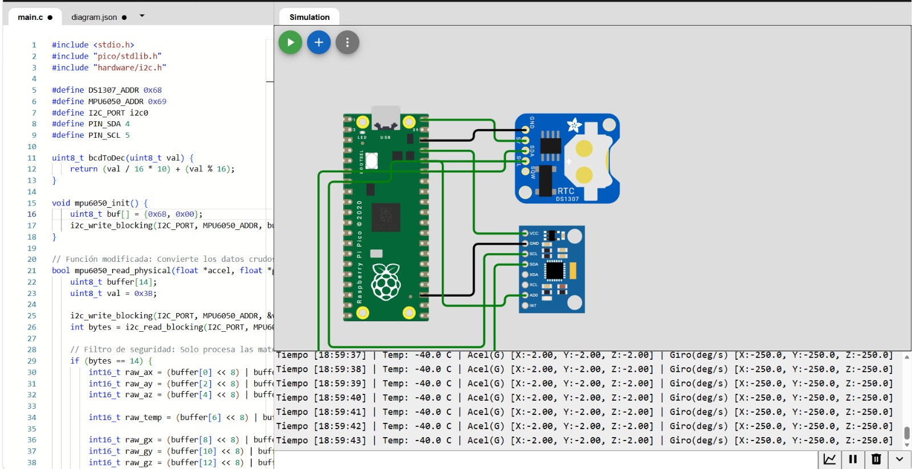

## Goal

Our goal was to read the time from a DS1307 and motion and temperature data from an MPU6050 over I2C.

## Prediction

We expected to read the clock time and MPU6050 movement at the same time over the same two wires, SDA and SCL.

## Setup

We connected I2C0 SDA to GP4 and SCL to GP5. Our code uses address 0x68 for the DS1307 and 0x69 for the MPU6050, and sets I2C to 400 kHz. We note that the DS1307 supports up to 100 kHz, so our 400 kHz setting is above its limit. We used the Pico SDK serial output to see the readings.

## What I did

We set up I2C0 and started the MPU6050. In a loop, we read the RTC time and 14 bytes from the MPU6050. Our code checked each read, converted the sensor values, printed the results or an error, and waited one second.

## Evidence



## Predicted vs measured

We saw the time update every second and the acceleration values change when we tilted the sensor. Our code sets I2C to 400 kHz, which is above the DS1307 100 kHz limit, so this result does not confirm reliable operation within the clock specification.

## What went wrong

Both devices used address 0x68 at first, so our code could not read them as separate devices. We connected the MPU6050 AD0 pin to 3.3 V to change its address to 0x69. Then they worked together.

## Code

```c

// Tema: 4. Protocolos de Comunicación (I2C)

#include <stdio.h>
#include "pico/stdlib.h"
#include "hardware/i2c.h"
 
#define DS1307_ADDR 0x68
#define MPU6050_ADDR 0x69
#define I2C_PORT i2c0
#define PIN_SDA 4
#define PIN_SCL 5
 
uint8_t bcdToDec(uint8_t val) {
    return (val / 16 * 10) + (val % 16);
}
 
void mpu6050_init() {
    uint8_t buf[] = {0x6B, 0x00};
    i2c_write_blocking(I2C_PORT, MPU6050_ADDR, buf, 2, false);
}
 
// Función modificada: Convierte los datos crudos a unidades físicas (float) y retorna true/false si tuvo éxito
bool mpu6050_read_physical(float *accel, float *gyro, float *temp) {
    uint8_t buffer[14];
    uint8_t val = 0x3B;
   
    i2c_write_blocking(I2C_PORT, MPU6050_ADDR, &val, 1, true);
    int bytes = i2c_read_blocking(I2C_PORT, MPU6050_ADDR, buffer, 14, false);
 
    // Filtro de seguridad: Solo procesa las matemáticas si leyeron los 14 bytes exactos
    if (bytes == 14) {
        int16_t raw_ax = (buffer[0] << 8) | buffer[1];
        int16_t raw_ay = (buffer[2] << 8) | buffer[3];
        int16_t raw_az = (buffer[4] << 8) | buffer[5];
       
        int16_t raw_temp = (buffer[6] << 8) | buffer[7];
       
        int16_t raw_gx = (buffer[8] << 8) | buffer[9];
        int16_t raw_gy = (buffer[10] << 8) | buffer[11];
        int16_t raw_gz = (buffer[12] << 8) | buffer[13];
 
        // Escalas físicas del Datasheet
        accel[0] = raw_ax / 16384.0f;
        accel[1] = raw_ay / 16384.0f;
        accel[2] = raw_az / 16384.0f;
 
        *temp = (raw_temp / 340.0f) + 36.53f;
 
        gyro[0] = raw_gx / 131.0f;
        gyro[1] = raw_gy / 131.0f;
        gyro[2] = raw_gz / 131.0f;
       
        return true;
    }
    return false;
}
 
// Función modificada: Retorna true/false si logró leer el reloj
bool ds1307_read_time(uint8_t *hour, uint8_t *minute, uint8_t *second) {
    uint8_t reg = 0x00;
    uint8_t buffer[3];
 
    i2c_write_blocking(I2C_PORT, DS1307_ADDR, &reg, 1, true);
    int bytes = i2c_read_blocking(I2C_PORT, DS1307_ADDR, buffer, 3, false);
 
    if (bytes == 3) {
        *second = bcdToDec(buffer[0] & 0x7F);
        *minute = bcdToDec(buffer[1]);
        *hour   = bcdToDec(buffer[2] & 0x3F);
        return true;
    }
    return false;
}
 
int main() {
    stdio_init_all();
 
    // 400 kHz es la velocidad recomendada ("Fast Mode") para leer sensores rápidamente
    i2c_init(I2C_PORT, 400 * 1000);
    gpio_set_function(PIN_SDA, GPIO_FUNC_I2C);
    gpio_set_function(PIN_SCL, GPIO_FUNC_I2C);
    gpio_pull_up(PIN_SDA);
    gpio_pull_up(PIN_SCL);
 
    mpu6050_init();
    sleep_ms(1000);
 
    // Arreglos de tipo float para almacenar los datos ya convertidos
    float accel[3], gyro[3], temp;
    uint8_t hour, minute, second;
 
    while (true) {
        // Ejecutamos las lecturas y revisamos si fueron exitosas
        bool rtc_ok = ds1307_read_time(&hour, &minute, &second);
        bool mpu_ok = mpu6050_read_physical(accel, gyro, &temp);
 
        // Imprimimos el reloj
        if (rtc_ok) {
            printf("Tiempo [%02u:%02u:%02u] | ", hour, minute, second);
        } else {
            printf("Tiempo [Error de I2C] | ");
        }
 
        // Imprimimos los sensores
        if (mpu_ok) {
            printf("Temp: %.1f C | ", temp);
            printf("Acel(G) [X:%.2f, Y:%.2f, Z:%.2f] | ", accel[0], accel[1], accel[2]);
            printf("Giro(deg/s) [X:%.1f, Y:%.1f, Z:%.1f]\n", gyro[0], gyro[1], gyro[2]);
        } else {
            printf("MPU6050 [Error de I2C]\n");
        }
 
        sleep_ms(1000);
    }
    return 0;
}
```

## Open question

How many different I2C sensors can we connect to the same two Pico pins?
